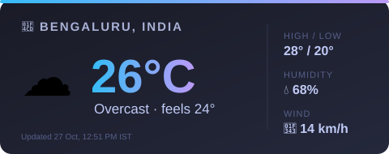

<!-- ===== HEADER BANNER ===== -->
<p align="center">
  
</p>

<!-- ===== TYPING ANIMATION ===== -->
<p align="center">
  <a href="https://git.io/typing-svg">
    
  </a>
</p>

<!-- ===== QUICK BADGES ===== -->
<p align="center">
  <a href="https://www.linkedin.com/in/dikshant-mitrav-985931208/"></a>
  <a href="mailto:mitravdikshant2002@gmail.com"></a>
  
</p>

---

## 🧑‍💻 About Me

```yaml
name:      Dikshant Mitrav
role:      Product Manager, Data & AI
based_in:  Bengaluru, India 🇮🇳
journey:   Data Ops → Associate Analyst → Senior Data Analyst → PM
superpower: "Deciding what to build AND judging whether the AI performs"
currently: Building public projects on AI evals & data quality
```

### 🧭 What I do
- 🎯 **Own AI products end-to-end:** features, roadmap, UX, quality bar, release sign-off
- 🧪 **Evaluate AI quality:** compare versions, decide when a product is ready to ship
- 🧹 **Fix messy data at scale:** validation, dedupe, fake-profile detection across millions of records
- ⚙️ **Automate with LLMs:** MCP integrations + open-source models across Jira, Slack & Google

### 📈 Highlights
| 🏆 Impact | 📊 Result |
|----------|-----------|
| Fake-profile detection (rule-based) | **90%+ fakes caught, <10% false positives** |
| Data validation work | **40%+ fewer errors reaching customers** |
| Internal LLM automation | **20–40% less paid-AI dependency, 20+ users** |
| ML research | **IEEE Conference, 2022** |

---

## 🚀 Featured Projects

| Project | What it shows | Status |
|---------|---------------|--------|
| 🕵️ **Fake-Profile Risk Scorer** | Heuristic scoring, explainability, precision/recall trade-offs | 🚧 Building |
| 🏷️ **Job Title Normalizer** | Rules vs. LLM vs. hybrid on messy B2B data | 🔜 Planned |
| 📏 **LLM Enrichment Accuracy Benchmark** | How often LLMs get company facts wrong | 🔜 Planned |
| 🔍 **AI Product Teardowns** | Product sense on Clay, Apollo, Perplexity & more | 🔜 Planned |

---

## 🛠️ Toolkit

<p align="center">
  
</p>

<p align="center">
  
  
  
  
  
  
  
  
  
  
</p>

---

## 📊 GitHub Stats

<p align="center">
  
  
</p>

<p align="center">
  <picture>
    <source media="(prefers-color-scheme: dark)" srcset="https://raw.githubusercontent.com/DikshantMitrav/Dikshantmitrav/output/github-snake-dark.svg" />
    <source media="(prefers-color-scheme: light)" srcset="https://raw.githubusercontent.com/DikshantMitrav/Dikshantmitrav/output/github-snake.svg" />
    
  </picture>
</p>

---

## 🌦️ Live from Bengaluru

<p align="center">
  
</p>

---

## 💬 Quote of the Moment

<p align="center">
  
</p>

<details>
  <summary>😄 <b>Need a laugh? Click for a random dev joke</b></summary>
  <p align="center">
    
  </p>
</details>

---

<!-- ===== FOOTER ===== -->
<p align="center">
  
</p>
